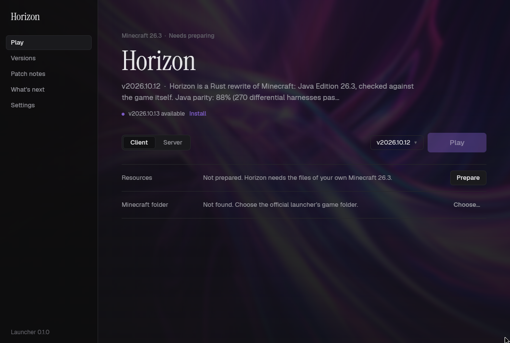

# Kydra Launcher

Um launcher de Minecraft feito em cima do [**Horizon**](https://github.com/horizon-rust/horizon) —
o Minecraft: Java Edition 26.3 reescrito do zero em **Rust** e conferido contra o vanilla com
281 harnesses diferenciais. A interface é o **Kydra**, com tema verde (aurora / floresta).

> Este repositório serve como **memória do projeto**: tudo está em pastas com um papel claro, e
> cada decisão de produto, dado de referência e contrato de API está escrito em `docs/`.



<sub>Acima, a referência de layout (launcher oficial do Horizon). As capturas do Kydra ficam em
`design/screenshots/` — veja o README de lá.</sub>

---

## O que ele faz

| Página | O que resolve |
| --- | --- |
| **Jogar** | Herói com a build atual, `Jogar` num clique (instala → prepara → abre), versão e instância ao lado. |
| **Versões** | Lista as builds do `horizon-rust/horizon`, instala em pasta própria, remove sem resíduo, importa build compilada por você. Filtro por estável / nightly / instaladas e barra de parity por build. |
| **Mods** | Busca no registro do Horizon e no Modrinth, com selo **Funciona / Em parte / Não roda ainda** por mod. Aba de modpacks com relatório de cobertura. |
| **Instâncias** | Pastas de jogo separadas, com nome, grupo, cor e tempo de jogo. Renomear não move nada no disco. |
| **Servidores** | Criar, iniciar, parar, reiniciar, backup e console — tudo pelo `horizon-server`. TPS, MSPT e RAM ao vivo. |
| **Notas de patch** | O que mudou em cada release, em texto de gente. |
| **O que vem depois** | Roadmap do Horizon com status e progresso honesto. |
| **Ajustes** | Conta, atualização automática, canal, memória, Java, abertura, menus do jogo, argumentos, aparência, coleta de dados e local dos dados. |

A interface fala com um backend (`backend/`) por `/api`. Se ele não responder, o launcher entra
sozinho em **modo demonstração**: catálogo embutido + estado em `localStorage`. É o modo que roda
no preview do navegador.

---

## Como rodar

```bash
npm start          # sobe a interface + API em http://localhost:8787
npm test           # 17 testes: rotas, fluxos (jsdom) e contrato do backend
npm run check      # sintaxe dos pontos de entrada
```

Sem dependências de runtime: só Node 20+. `jsdom` é a única dependência de desenvolvimento
(usada pelos testes).

**Backend em Rust (opcional):** `cd backend-rust && cargo run --release` serve exatamente o mesmo
contrato (`docs/API.md`) e o mesmo catálogo, sem nenhuma dependência de crate.

---

## Mapa das pastas

```
.
├── index.html              # casca do app (SPA por hash)
├── package.json            # scripts: start / test / check
├── assets/                 # arte que não é código (fundo do herói)
│   └── hero-aurora.jpg
├── src/
│   ├── assets/
│   │   └── logo.svg        # marca Kydra (escudo + K)
│   ├── styles/
│   │   ├── tokens.css      # cor, tipo, espaço, raio, movimento (fonte única)
│   │   ├── base.css        # reset, tipografia, foco, scrollbar
│   │   ├── layout.css      # sidebar, páginas, abertura, responsivo
│   │   ├── components.css  # botões, pills, linhas, chips, toggle, console, toasts
│   │   └── views.css       # estilos por página (herói, versões, mods, servidores…)
│   └── js/
│       ├── app.js          # rotas, sidebar, tema, abertura, re-render
│       ├── store.js        # estado + persistência + backend real/demonstração
│       ├── icons.js        # ícones SVG inline
│       ├── ui.js           # DOM, escape, toasts, modal, console, formatadores
│       ├── data/
│       │   ├── builds.json # catálogo de builds (lido pela interface E pelos backends)
│       │   └── builds.js   # patches, roadmap, mods, modpacks
│       ├── components/
│       │   └── account.js  # modal de conta (Microsoft / offline)
│       └── views/
│           ├── play.js     ├── versions.js  ├── notes.js     ├── next.js
│           ├── mods.js     ├── instances.js ├── servers.js   └── settings.js
├── backend/
│   └── server.mjs          # estático + /api/health|versions|install|prepare|play (Node)
├── backend-rust/
│   ├── Cargo.toml
│   └── src/main.rs         # o mesmo contrato, em Rust, sem dependências
├── tests/
│   ├── smoke.test.mjs      # rotas, instalação, conta, ajustes, servidores…
│   └── backend.test.mjs    # catálogo único + contrato Node/Rust + HTTP real
├── docs/                   # a memória escrita do projeto
│   ├── ARCHITECTURE.md     # camadas, fluxo de dados, por que assim
│   ├── API.md              # contrato HTTP entre interface e backend
│   ├── HORIZON.md          # o que é o Horizon, como o launcher o alimenta
│   └── ROADMAP.md          # próximos passos do Kydra
└── design/
    ├── DESIGN.md           # sistema visual: cor, tipo, espaço, componentes
    └── screenshots/        # capturas de referência (+ como capturar as do Kydra)
```

---

## Licença e créditos

- O jogo, o preparador e o servidor são do projeto **horizon-rust/horizon** (LGPL-3.0-or-later).
- A interface do Kydra segue a linguagem visual do launcher do Horizon (sidebar, linhas com
  divisores, um botão primário por tela), com o tema verde próprio.
- Minecraft é marca da Mojang/Microsoft. O Kydra não distribui arquivos do jogo: ele usa a sua
  instalação ou baixa da Mojang com a sua conta.
